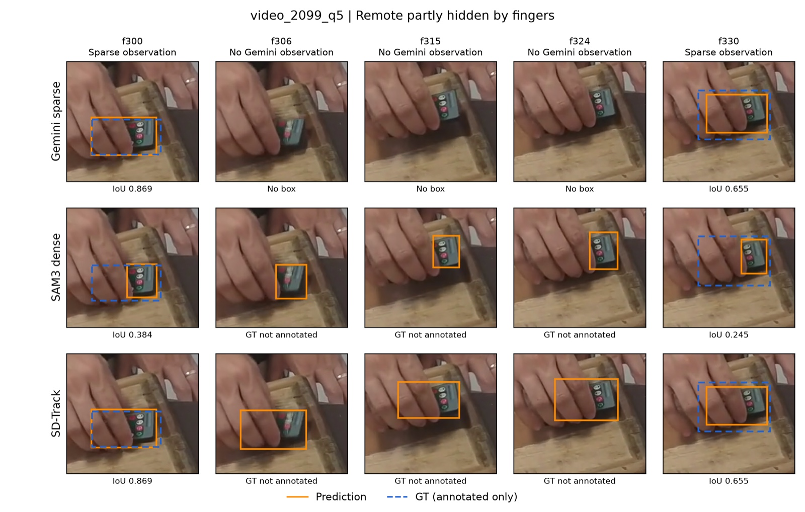

# SD-Track

**Sparse-to-Dense Amodal Fusion for Question-Guided Tracking**

SD-Track finds the objects that answer a video question and predicts a box trajectory for each. Gemini identifies the targets and selects anchor frames, SAM3 follows those identities on a dense frame grid, and sparse amodal boxes from Gemini correct the dense trajectories through partial and full occlusion.

## Quick start

Clone the repository and run the included example with Python 3.8 or later. The example runs offline on a CPU using only the Python standard library.

```sh
git clone https://github.com/BananaBats/2026-ECCV-Grounded-VQA.git
cd 2026-ECCV-Grounded-VQA
python3 demo.py
```

The example tracks a launched remote control in Perception Test validation clip `video_2099` (question 5). It fuses the saved SAM3 and Gemini boxes and checks the object IDs, frame indices, and coordinates against the archived prediction.

```text
1 track, 543 boxes. Saved to outputs/tracks.json
```

The JSON records zero-based source frame indices and normalized `[xmin, ymin, xmax, ymax]` boxes for each target.



At frame 315, SD-Track corrects the SAM3 box using Gemini observations from frames 300 and 330. Orange boxes show predictions. Dashed blue boxes show ground truth on the annotated frames.

## How it works

1. **Plan.** Gemini uses the video and question to identify target instances, select anchors, and estimate visibility intervals.
2. **Track.** SAM3 propagates the anchor prompts to build dense trajectories with consistent identities.
3. **Localize sparsely.** Gemini estimates boxes for the same identities, including the parts hidden by occlusion.
4. **Fuse.** On shared frames, same-ID Gemini and SAM3 boxes with sufficient overlap define coordinate residuals. SD-Track interpolates these residuals along the dense track and keeps sparse observations where a SAM3 box is missing. It fills remaining temporal gaps when the endpoint boxes have sufficient overlap.

The demo and val200 replay use an IoU threshold of 0.30 for both overlap checks. See the [fusion implementation](sdtrack/fusion.py) and [benchmark protocol](reproduction/PROTOCOL.md) for the settings used across experiments.

## Reproduce the validation results

The repository includes the saved observations and public validation annotations for 200 Perception Test questions from 190 videos. The replay recomputes the scores on CPU. Installing the dependencies requires internet access.

```sh
python3.11 -m venv .venv-eval
.venv-eval/bin/python -m pip install -r reproduction/benchmarks/requirements-core.txt
.venv-eval/bin/python -m reproduction.replay --output-dir outputs/val200
```

| Method on Perception Test val200 | HOTA (0–100) |
| --- | ---: |
| Dense SAM3 | 66.861 |
| Sparse Gemini + linear interpolation | 65.611 |
| SD-Track | **71.802** |
| SD-Track without positive box-size correction | 69.170 |
| Direct Gemini | 72.550 |

The replay checks all 183,035 fused boxes, regenerates the 1,001-point shared-threshold sweep, and evaluates residual transfer with alternate Gemini observations withheld. On the eligible holdout frames, residual transfer at 0.30 raises HOTA from 78.690 to 79.405. The command writes `summary.json`, `shared_tau.csv`, and `holdout.csv` under `outputs/val200/`.

See the [ordered query list](reproduction/data/perception_val200.tsv) and [experiment protocol](reproduction/PROTOCOL.md) for cohort selection, metrics, prompts, and benchmark settings. Re-running the official test evaluations requires the corresponding datasets or evaluation services.

## Run inference on a video

Live inference requires Linux, Python 3.12, an NVIDIA GPU with a CUDA 12.8-compatible driver, Git, FFmpeg, and the original [SAM3 checkpoint](https://huggingface.co/facebook/sam3). Configure Application Default Credentials for a Vertex AI project with access to the selected Gemini model. Live inference sends video inputs to Vertex AI and incurs API charges.

```sh
python3.12 -m venv .venv
.venv/bin/python -m pip install -r requirements-live.txt
.venv/bin/python demo.py --live --project YOUR_PROJECT --checkpoint /path/to/sam3.pt
```

Without `--video`, this runs the models on the bundled example and writes `outputs/live_tracks.json`. To track targets in your own clip, add `--video /path/to/video.mp4 --question "Which person picks up the bag?"`. The query determines whether the target is a person, a body part, or an object. Use `--target-kind person` or `--target-kind object` to restrict the target type. The bundled example uses object-only selection.

The demo defaults to the archived Perception Test model ID `gemini-3.7-flash`. Pass `--model MODEL_ID` to select an available deployment. The demo uses the Perception Test sampling schedule. Benchmark-specific planners, frame maps, and exporters are in the reproduction package.

## Repository layout

| Path | Contents |
| --- | --- |
| [`demo.py`](demo.py) | Offline example and live inference entry point |
| [`sdtrack/`](sdtrack) | Planning, SAM3 tracking, sparse localization, and fusion |
| [`examples/remote_control/`](examples/remote_control) | Example clip, model observations, and expected trajectory |
| [`reproduction/`](reproduction) | Val200 replay, saved inputs, evaluator, and reference curves |
| [`reproduction/benchmarks/`](reproduction/benchmarks) | Benchmark configurations, archived implementations, frame maps, and exporters |

## Credits

The example video, questions, and validation annotations are from Pătrăucean et al., *Perception Test* (2023), © 2022 DeepMind Technologies Limited, licensed under CC BY 4.0. The preview crops source frames and overlays annotations and predictions. The validation cache contains selected annotation fields and model outputs. [Dataset](https://github.com/google-deepmind/perception_test) · [CC BY 4.0](https://creativecommons.org/licenses/by/4.0/)
